# Armor Craft

Design full suits of plate armor and sculpt your own helmet. Built in Godot 4.4 (Compatibility renderer, so it runs in the browser on integrated graphics).

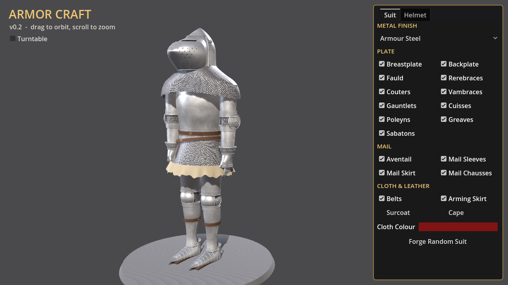
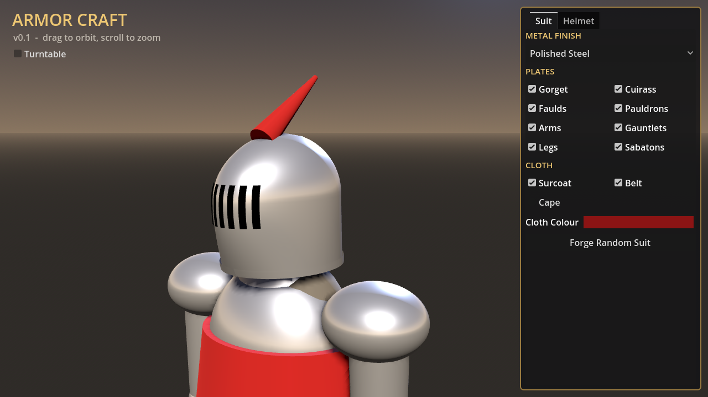
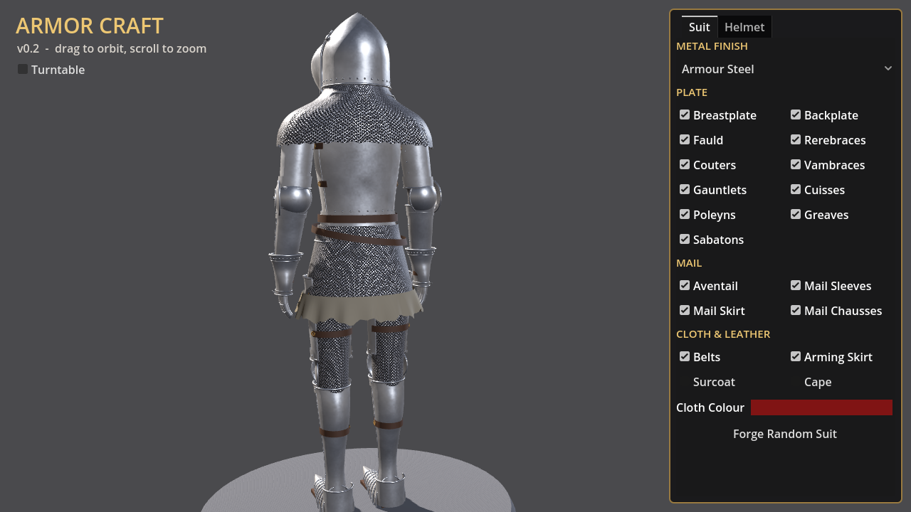

**Proportions vs. reference** (left of each pair: reference, right: Armor Craft)

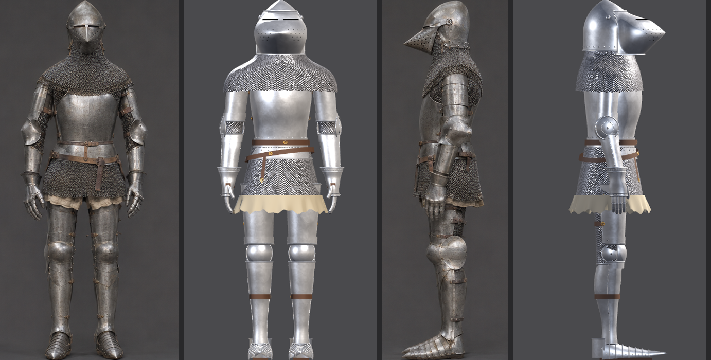

## v0.12 – cuirass traced from a reference sheet

The cuirass is traced from a front / side / back reference: the outline in each view is measured row by row and turned into width and depth profiles at every height, scaled onto the wooden mannequin.

- **Mid section:** breastplate and backplate with a round chest, wide shallow neckline, open armholes and narrow shoulder tabs. They meet at a seam on each side.
- **Bottom section:** the fauld, one band that flares out below the waist, with the lower edge dipping at the front.
- **Leather:** straps riveted to the front and back tabs join them over each shoulder; a belt across the front sits on the division with a buckle and hanging tail; buckled straps cross each side seam on the plates and on the fauld.
- Neck and armholes are cut along smooth curves (marching-triangle clipping on the shell grid) and every cut edge gets a rolled edge.
- Where the mannequin is fuller than the reference wearer, the profiles are widened just enough to clear it and then smoothed. A test measures the gap from every piece to the wood (at least 5 mm).

Cuirass tab: show or hide the breastplate, backplate, fauld, shoulder straps and belts. Source: `scripts/pieces/cuirass.gd` (traced tables at the top).

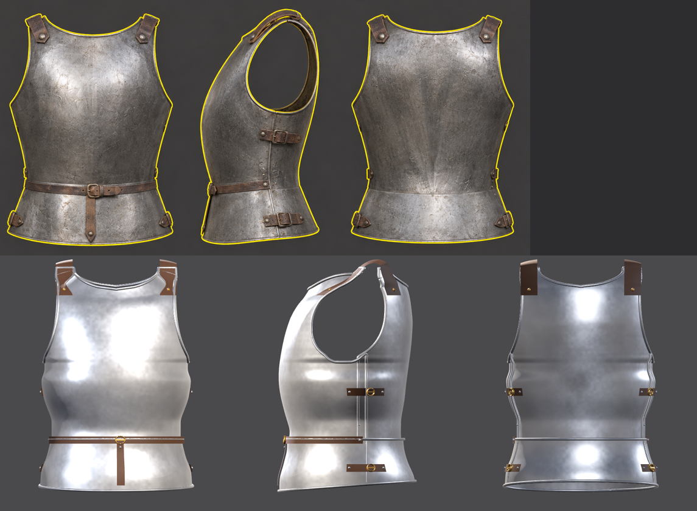
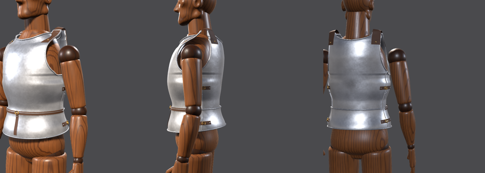

## v0.9 – add holes

Punch real holes through the spangenhelm. In the Helmet tab press **Add Holes**, pick a shape (**Round**, **Slot**, **Cross**), set its size, and click the helmet: a gold outline previews the hole under the cursor, a click cuts it, and clicking an existing hole removes it. **Mirror** places a matching hole on the other side. **Eye Slits** and **Breaths** add a ready-made set (stretching the helmet over the face if needed); **Undo Hole** and **Clear Holes** do what they say.

Holes are pinned to the surface by angle and height, so they ride along when you stretch or skew the helmet, sleep when the helmet is shortened past them, and come back when it's stretched again. They're cut per pixel in the metal shader (up to 64 per helmet), shadows included.

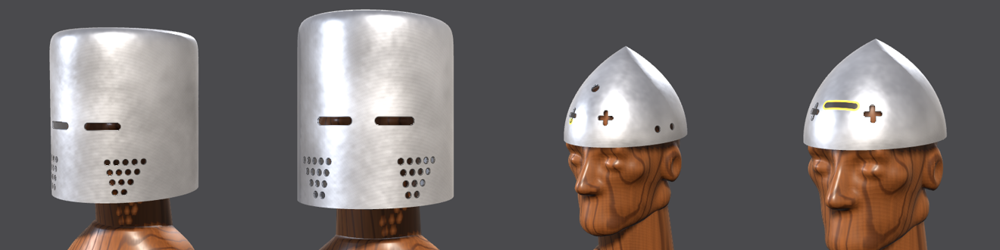

## v0.8 – stretch & skew

Click the spangenhelm to select it (it glows) and two handles appear:

- **Stretch** (down arrow, front edge): drag down to extend the walls below the brow, over the face and down to the chin. Once it passes the eyes the shell widens slightly so it clears the nose.
- **Skew** (double arrow, crown): drag up to turn the round dome into a pointed gothic arch; drag down to flatten it into a bucket-helm top with straight sides.

The Helmet tab has matching **Stretch** and **Skew** sliders and **Dome / Pointed / Bucket** presets. Click empty space to deselect; dragging anywhere else still orbits the camera. The shell is generated live (`scripts/pieces/shaped_helmet.gd`, handles in `shape_gizmo.gd`), and a test checks the head stays inside it for every combination.

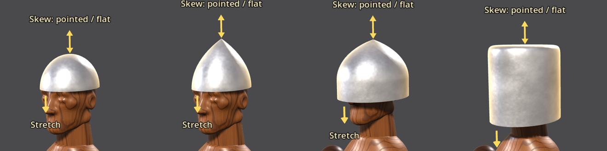

## v0.7 – carved head

The mannequin's head is reshaped from a reference outline: fuller rounded skull with the back of the head bulging behind the neck, upright forehead, brow ridge, eye sockets with closed lids, nose, lips, cheekbones, a defined jaw and chin, and ears. The neck is thicker and leans slightly forward into the back of the jaw.

It's carved from blended shapes (a signed-distance sculpt in `build_mannequin.py` → `head_sdf`), scaled by `head_width`, `head_depth`, and chin-to-crown height from `measurements.json`. The spangenhelm was refitted to clear the new head by at least 3 mm.

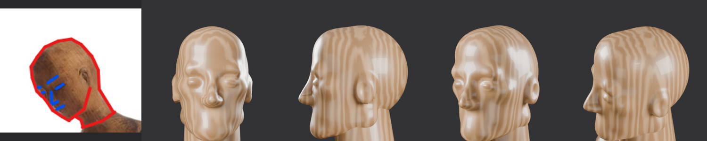
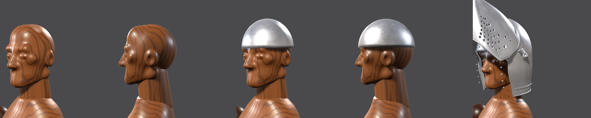

## v0.6 – spangenhelm (simple shapes first)

Helmets now start from simple shapes and get detail added step by step. First up, the **spangenhelm**: a plain half-sphere shell, 2 mm thick, in the hammered-steel finish, fitted to the mannequin's head with the rim on the brow. It's the default helmet; the hounskull bascinet and the procedural designer are still in the Helmet dropdown.

Source: `art/blender/build_helmet_spangenhelm.py` (four numbers: rim height, width, depth, dome height) and `helmet_spangenhelm.blend`.

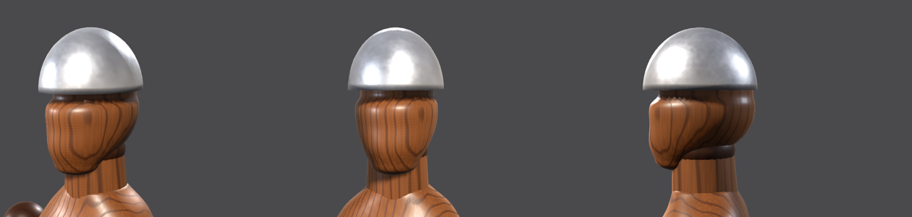

## v0.5 – the wooden mannequin

Everything is now fitted to a **jointed wooden artist's mannequin**, traced from an outline drawn over the reference harness.

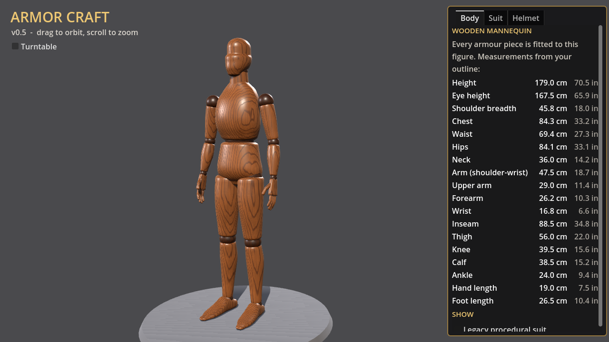

**Outline vs. mannequin** (red lines: the traced outline)

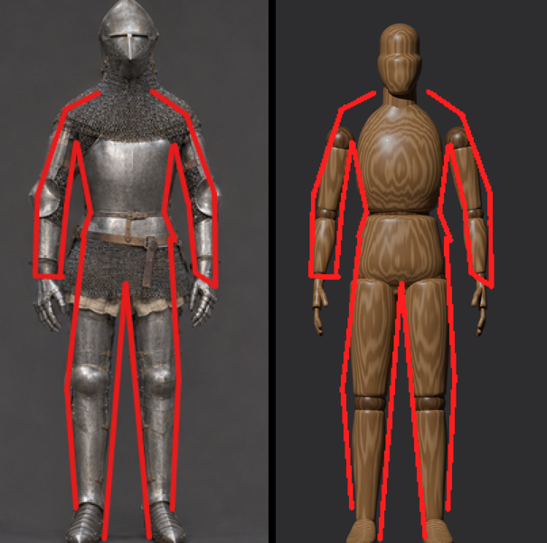

- All proportions live in **`assets/mannequin/measurements.json`** (metres): height, eye level, shoulder breadth, chest/waist/hip width and depth, joint heights, limb girths, hand and foot sizes. `art/blender/build_mannequin.py` rebuilds the figure from that file; the Body tab in game lists the same numbers in cm and inches.
- Exported as a **joint hierarchy** (Pelvis → Waist → Chest → Neck → Head; Shoulder → Elbow → Wrist; Hip → Knee → Ankle, left and right) with the carved segments hanging off each joint, so the game can pose it by rotating joints and apply new measurements by moving joints and scaling segments.
- Armour attaches to **sockets**: the bascinet now sits on `Socket_Head` (eye level). More sockets get added as each piece is modelled.
- Procedural varnished-wood shader (`shaders/wood.gdshader`), darker wood on the ball joints.
- The older all-in-one procedural suit is still there, hidden by default (Body tab → Show → Legacy procedural suit).

## v0.4 – modelled pieces

Armour is moving from one procedural suit to **separately modelled pieces** that snap onto the mannequin at sockets. The first is the **hounskull bascinet**, modelled in Blender:

- Pointed skull with the face opening actually cut out, 1.8 mm plate thickness, padded leather lining
- Pig-faced visor with a real eye slit (split by a centre bar) and 51 breath holes, rolled edges everywhere
- Hinge arms, rosette pivot bosses, lining rivets, and vervelles round the rim for the aventail
- Shape keys exported as morphs: **Width, Height, Apex, Snout** (sliders go negative too), plus **Visor Raised** on the hinge

The source is a script, `art/blender/build_helmet_bascinet.py`, so the model rebuilds from numbers; the `.blend` sits next to it for hand-tweaking in Blender. Export goes to `assets/pieces/helmet_bascinet.glb`, and `scripts/pieces/helmet_piece.gd` loads any piece, swaps in the game's steel shader, and drives its morphs.

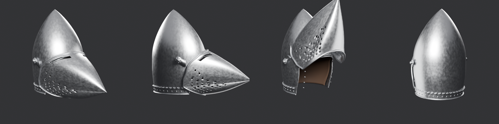

## v0.3 – what's in

Body proportions are measured off the reference (about seven helmets tall, 1.86 m to the bascinet apex) and live as named landmarks at the top of `scripts/suit_builder.gd`: shoulder, elbow, wrist, waist, hem, knee, plus arm and leg centre-lines. Change one number and every piece follows.


**The harness** (modelled on an Italian-style harness, c. 1400–1420), every piece procedural:
- Hounskull bascinet: pointed apex, pig-faced visor with eye slit and breaths, rosette pivots, aventail vervelles
- Mail aventail cape, mail sleeves, mail skirt over a linen arming skirt, mail at the backs of the thighs
- Globose breastplate and backplate with rolled edges, side straps and buckles; two fauld lames
- Rerebraces, couters with fan wings, hinged vambraces, hourglass gauntlets with articulated fingers and thumb
- Cuisses strapped over mail, poleyns with fan wings, greaves with hinge lines, pointed laminated sabatons
- Waist and hip belts with brass buckles, rivets throughout
- Hammered-steel shader (patina, hammer marks) and a four-in-one chainmail shader

**Suit tab:** toggle every plate, mail and cloth group; six finishes (armour steel, polished, blackened, brass, gilded, rusted); optional surcoat and cape with colour picker; Forge Random Suit.

**Helmet tab:** sculpt width, depth, height, dome, apex, taper, brim flare, snout; slit styles (horizontal, split eyes, T-visor, grille) with count/width/thickness/height; pig-face visor, breaths, plume and rolled rim toggles; five presets; Forge Random Helmet.

Drag to orbit, scroll to zoom, tick **Turntable** for a slow spin (good for clips).

## Play in the browser

Every push to `main` builds the web version and deploys it to GitHub Pages
(Settings → Pages → Source: **GitHub Actions**).

## Layout

```
project.godot
scenes/main.tscn          # single root node, everything built in code
scripts/main.gd           # world, materials, camera, UI
scripts/suit_builder.gd   # the full harness, grouped for toggling
scripts/helmet_builder.gd # procedural helmet + hounskull visor
scripts/mesh_kit.gd       # parametric surfaces, rolled edges, rivets
scripts/pieces/           # mannequin.gd + loaders for modelled pieces (helmet_piece.gd)
assets/pieces/            # exported .glb pieces
assets/mannequin/         # mannequin_wood.glb + measurements.json
art/blender/              # Blender build scripts, .blend sources, preview renderer
shaders/                  # hammered steel + chainmail
.github/workflows/        # web export + Pages deploy
```

## Roadmap ideas

- Plate articulation: overlapping lames that flex at elbow and knee
- Heraldry painter for surcoat and shield
- Customer commissions and a test yard (joust, arrows, mace strikes that dent weak designs)
